<div align="center">


# MedAppoint: Doctor Appointment Booking System built with Laravel

**Book doctor appointments online, pay securely with eSewa, and manage clinic schedules from one dashboard.**


</div>

MedAppoint is an open-source **doctor appointment and clinic management system** written in PHP with the Laravel framework. Patients find a doctor by specialization, book an open time slot and pay the consultation fee online through **eSewa**, Nepal's digital wallet. Doctors see their own schedule, and administrators manage doctors, specializations, time slots, users and every appointment from a single dashboard.

It suits small hospitals, clinics and private practices that want online booking without a large hospital management system, and it is a complete, tested reference project for anyone learning Laravel.

<p align="center">
  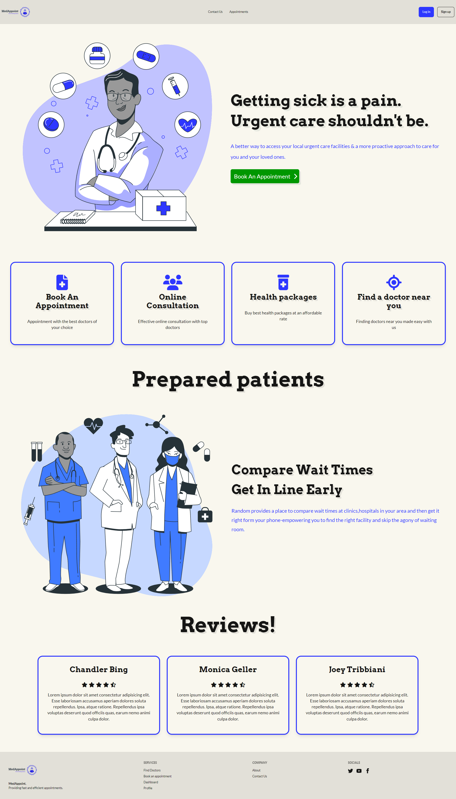
</p>

## Table of contents

- [Features](#features)
- [How booking and payment work](#how-booking-and-payment-work)
- [Tech stack](#tech-stack)
- [Screenshots](#screenshots)
- [Getting started](#getting-started)
- [Configuration](#configuration)
- [Usage](#usage)
- [Architecture and data model](#architecture-and-data-model)
- [Project structure](#project-structure)
- [Testing](#testing)
- [Security](#security)
- [Project documents](#project-documents)
- [Roadmap](#roadmap)
- [Contributing](#contributing)

## Features

### For patients

- Register with a patient profile (phone and address) and log in securely.
- Browse doctors grouped by specialization, with only open, upcoming time slots shown.
- Book a slot in two steps: pick it, then confirm. Each booking gets a unique token number.
- Pay the consultation fee online with eSewa. The appointment changes from **Unpaid** to **Booked** once eSewa confirms the payment.
- View and cancel your own appointments. Cancelling a future appointment frees the slot for other patients.
- Edit your profile and password, or delete your account.

### For doctors

- Register as a doctor under an existing specialization.
- Use a personal dashboard with total appointments, distinct patients and today's appointments.
- View and cancel your own appointments only.

### For administrators

- See clinic-wide totals of patients, doctors and appointments.
- Publish availability: pick a doctor, a time range and several dates, and matching slots are created without duplicates.
- Add medical specializations (for example Cardiologist, Dentist, Dermatologist).
- Manage users: edit name and email, promote a user to admin, or delete accounts with their related records.
- View and cancel any appointment.

### Platform

- Role-based access control for patients, doctors and admins, enforced by middleware and an appointment policy.
- A public contact form with validation and rate limiting.
- A responsive UI built with Tailwind CSS, DaisyUI and Alpine.js.

## How booking and payment work

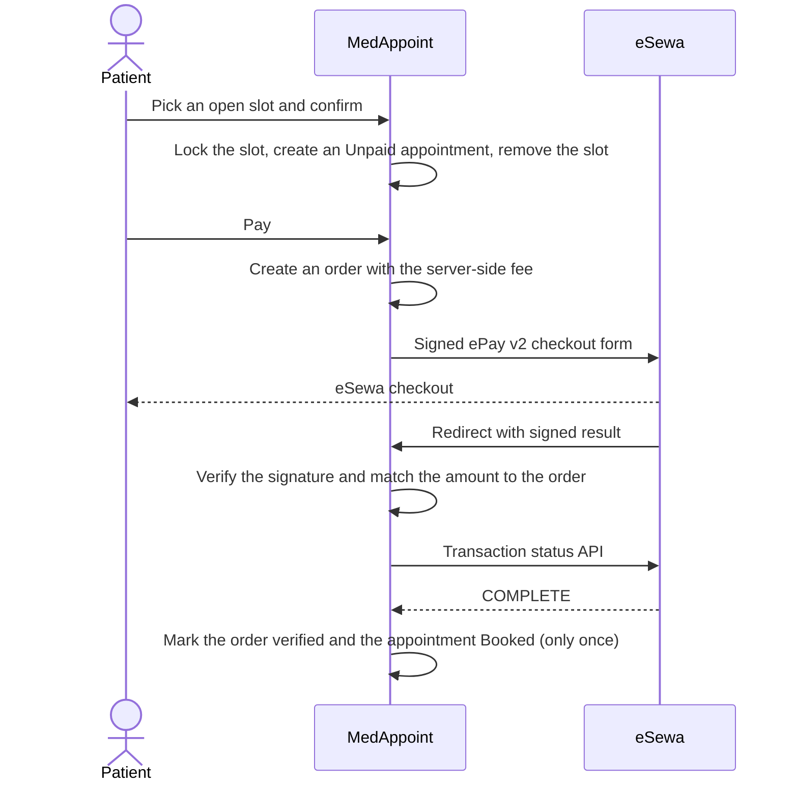

An appointment is never marked paid from the redirect alone. The signed callback must verify, its amount must match the order, and eSewa's status API must report `COMPLETE`.

## Tech stack

| Layer | Technology |
|---|---|
| Language | PHP 8.3+ |
| Framework | Laravel 13 |
| Authentication | Laravel Breeze controllers (session based), Laravel Sanctum for the API token route |
| Database | MySQL / MariaDB (SQLite in-memory for tests) |
| Frontend | Blade, Tailwind CSS 3, DaisyUI 4, Alpine.js 3, Vite 8 |
| Payments | eSewa ePay v2 via [`remotemerge/esewa-php-sdk`](https://github.com/remotemerge/esewa-php-sdk) |
| Testing | PHPUnit 12 (59 tests) |
| Code style | Laravel Pint |

## Screenshots

<details open>
<summary><strong>Booking an appointment</strong></summary>

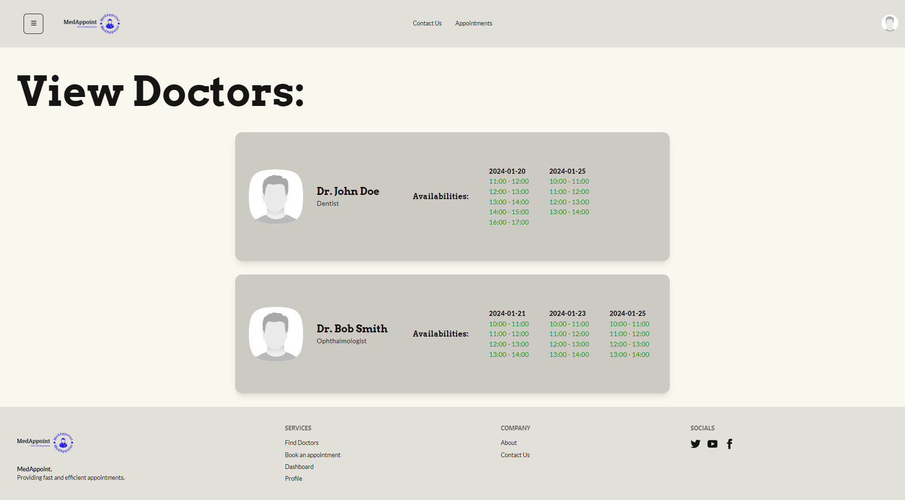

</details>

<details>
<summary><strong>Paying with eSewa</strong></summary>

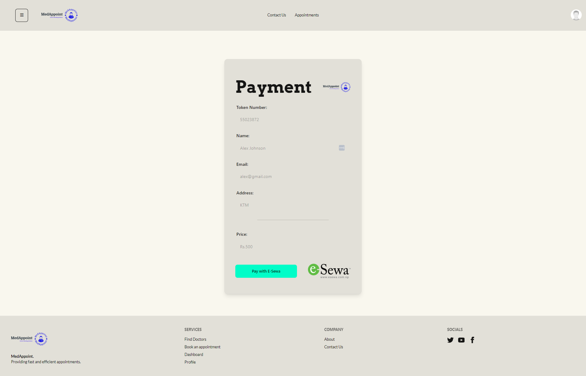
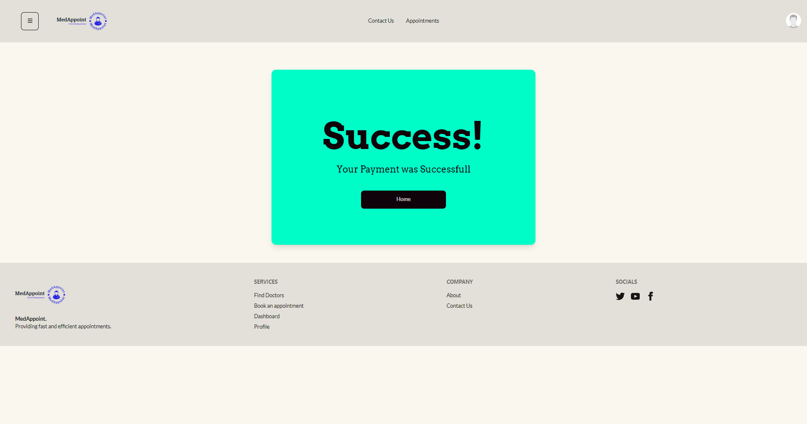

</details>

<details>
<summary><strong>Dashboards</strong></summary>

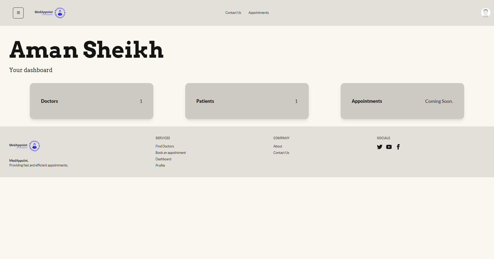
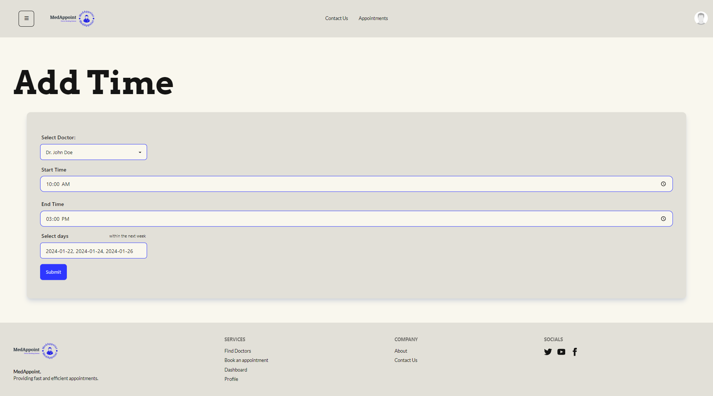
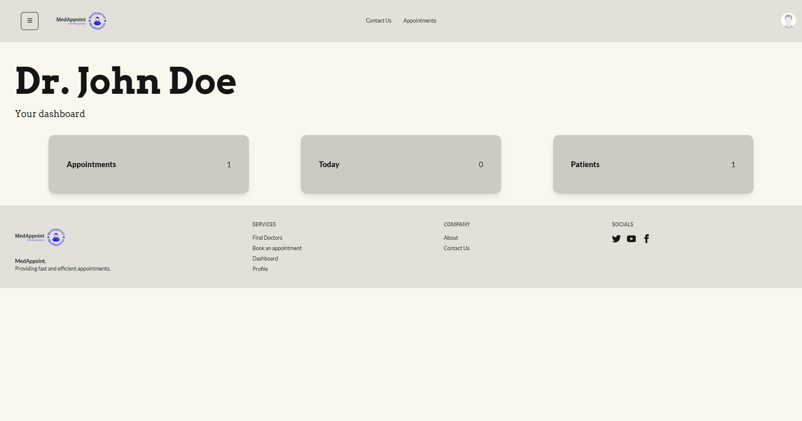
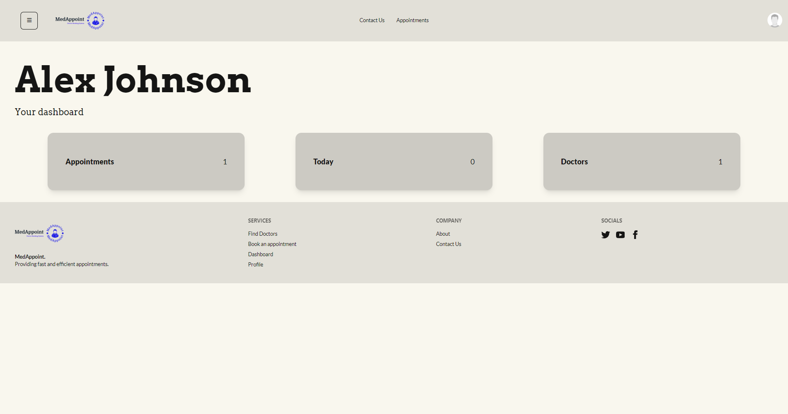

</details>

<details>
<summary><strong>Sign up and log in</strong></summary>

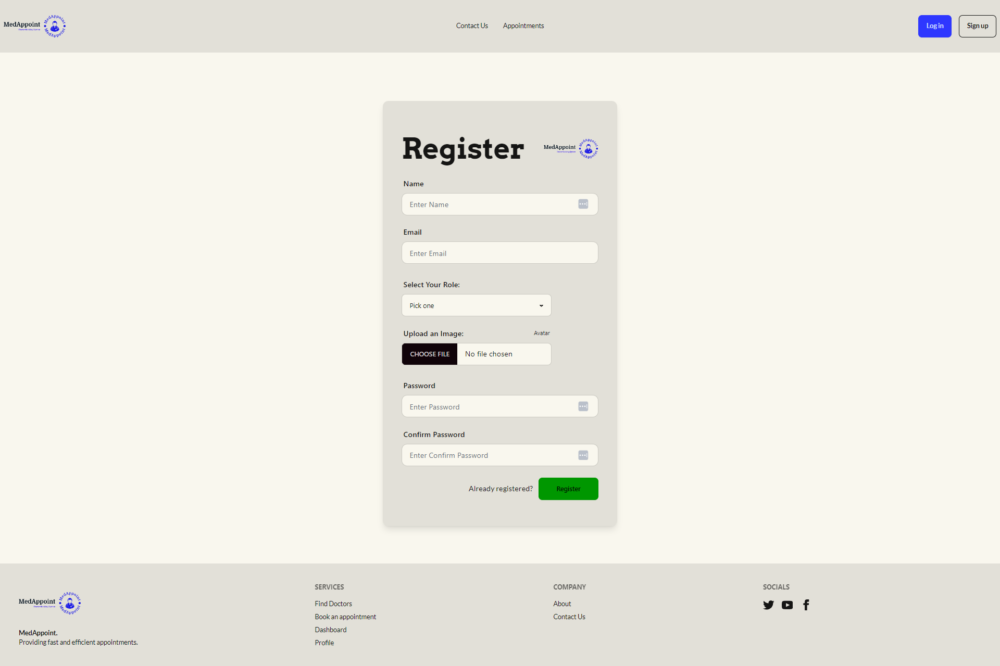
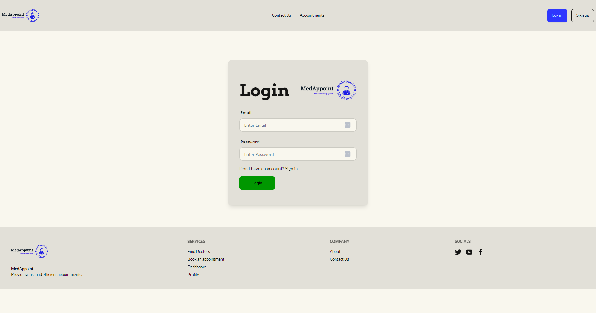

</details>

> [!NOTE]
> The screenshots were taken in January 2024. The layout is unchanged, but some internals (payments, access control) have been rebuilt since.

## Getting started

### Prerequisites

- PHP 8.3 or newer with the `curl`, `json`, `mbstring`, `openssl`, `pdo_mysql` and `fileinfo` extensions
- Composer 2
- Node.js 20.19+ or 22.12+ and npm
- MySQL 8 or MariaDB 10.6+

### Installation

```bash
git clone https://github.com/IntelligentBeaver/Doctor-Appointment-System.git
cd Doctor-Appointment-System

composer install
npm install

cp .env.example .env
php artisan key:generate
```

Create a database, set the `DB_*` values in `.env`, then run the migrations and seeders. The seeders add the default specializations and hourly time slots.

```bash
php artisan migrate --seed
php artisan admin:create admin@example.com --name="Clinic Admin"
```

Start the app:

```bash
npm run dev          # Vite dev server with hot reload
php artisan serve    # http://127.0.0.1:8000
```

For production, run `npm run build` instead of `npm run dev`.

## Configuration

| Variable | Default | Purpose |
|---|---|---|
| `APP_URL` | `http://localhost` | Base URL used to build the eSewa callback URLs |
| `DB_CONNECTION`, `DB_DATABASE`, `DB_USERNAME`, `DB_PASSWORD` | | Database connection |
| `ESEWA_ENVIRONMENT` | `test` | `test` or `production` |
| `ESEWA_PRODUCT_CODE` | `EPAYTEST` in test | Your eSewa merchant product code |
| `ESEWA_SECRET_KEY` | eSewa's public test key in test | HMAC secret for signing and verifying payments |
| `ESEWA_APPOINTMENT_FEE` | `500` | Consultation fee in NPR, charged by the server |

> [!WARNING]
> In `production`, no credentials are filled in for you. Set `ESEWA_PRODUCT_CODE` and `ESEWA_SECRET_KEY` to your merchant values, and set `APP_DEBUG=false`.

## Usage

1. **Admin:** log in at `/admin/login` with the account you created through `admin:create`. Add specializations under **Add Specialization** if needed, then publish slots under **Add Timeslots**.
2. **Doctor:** register at `/register`, choose *Doctor* and pick a specialization.
3. **Patient:** register at `/register`, choose *Patient*, open **Appointments**, pick a slot, confirm and pay.

To try payments in the test environment, use eSewa's sandbox account: eSewa ID `9806800001`, password `Nepal@123`, MPIN `1122`, OTP `123456`.

## Architecture and data model

MedAppoint is a classic three-tier Laravel MVC application.

- **Presentation:** Blade views styled with Tailwind CSS and DaisyUI, with Alpine.js for interactivity.
- **Application:** controllers grouped by role, an `AppointmentService` for the booking rules, an `AppointmentPolicy` for ownership checks, and role middleware.
- **Data:** MySQL through Eloquent models.

An `availabilities` row is an open slot for one doctor, date and time slot. Booking consumes it, and cancelling a future appointment puts it back.

<p align="center">
  
</p>

More diagrams (use case, activity, data flow, Gantt chart) are in [`docs/diagrams`](./docs/diagrams).

## Project structure

```text
app/
├── Console/Commands/CreateAdmin.php      # php artisan admin:create
├── Http/
│   ├── Controllers/
│   │   ├── Admin/                        # dashboard, login, specializations, time slots
│   │   ├── Auth/                         # registration, login, password reset (Breeze)
│   │   ├── Doctor/                       # doctor dashboard and appointments
│   │   ├── Patient/                      # patient dashboard and appointments
│   │   ├── Payment/EsewaController.php   # eSewa checkout and callbacks
│   │   ├── AppointmentController.php     # public listing, booking
│   │   └── ContactController.php
│   └── Middleware/                       # role checks: CheckAdmin, CheckDoctor, CheckPatient
├── Models/                               # User, Patient, Doctor, Appointment, Availability, Order, ...
├── Policies/AppointmentPolicy.php
└── Services/AppointmentService.php
docs/                                     # diagrams, screenshots, report, slides
resources/views/                          # Blade templates per role
tests/Feature/                            # auth, appointments, payments, admin
```

## Testing

The test suite runs on an in-memory SQLite database, so it never touches your development data.

```bash
php artisan test
vendor/bin/pint --test   # code style
```

The feature tests cover registration and login rules, booking (slot locking, tampering, past slots), cancellation permissions for each role, eSewa payment verification with genuine signatures, and admin user management.

## Security

- **Access control:** patients and doctors can only view, pay for or cancel their own appointments. Only admins reach admin routes.
- **No self-registration as admin:** the first admin is created from the command line with `admin:create`.
- **Payments:** fees are set on the server. Callbacks are verified with HMAC signatures and confirmed through eSewa's status API, and an order is fulfilled only once.
- **Concurrency:** a slot is locked while it is booked, so two patients cannot take the same slot.
- **Framework protections:** CSRF and request-forgery protection, rate-limited login and contact form, and hashed passwords.

If you find a vulnerability, please open a private security advisory on GitHub rather than a public issue.

## Project documents

This project started as an academic project. Its documents are kept in [`docs/`](./docs):

- [Mid-term report (PDF)](./docs/report/MedAppoint-MidTerm%20Report.pdf)
- [Presentation slides](./docs/slides)
- [Database table designs](./docs/database-tables)

## Roadmap

- Email notifications for booking, payment and cancellation
- Refund handling when a paid appointment is cancelled
- Doctor-managed availability (currently admin-only)
- Upgrade to Tailwind CSS 4 and DaisyUI 5
- Appointment search and pagination for large clinics

## Contributing

Contributions are welcome.

1. Fork the repository and create a branch, for example `feat/email-notifications`.
2. Add or update tests, then run `php artisan test` and `vendor/bin/pint`.
3. Open a pull request that describes the change.

Commit messages follow `<type>(<scope>): <summary>`, for example `fix(payments): verify amount in paisa`.
